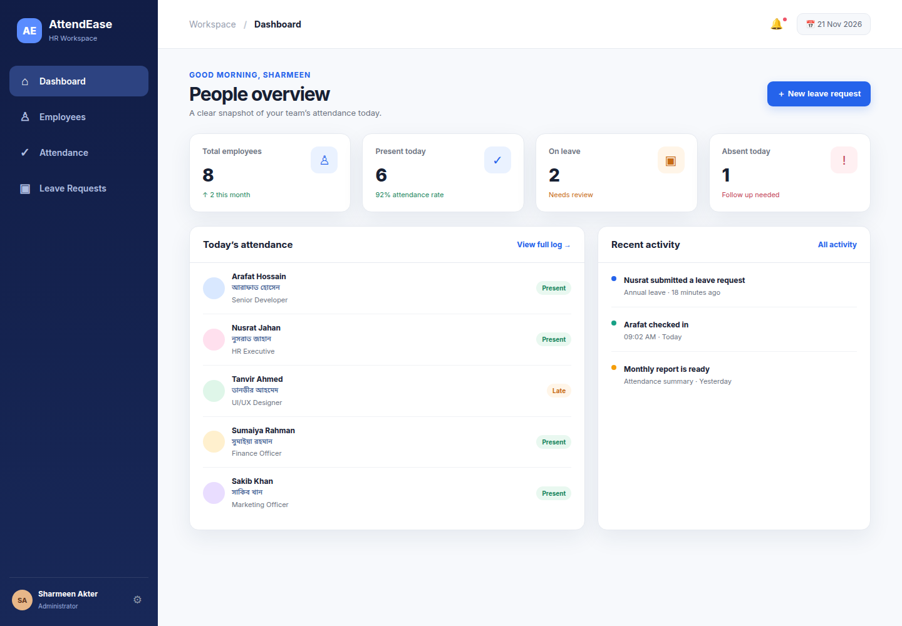
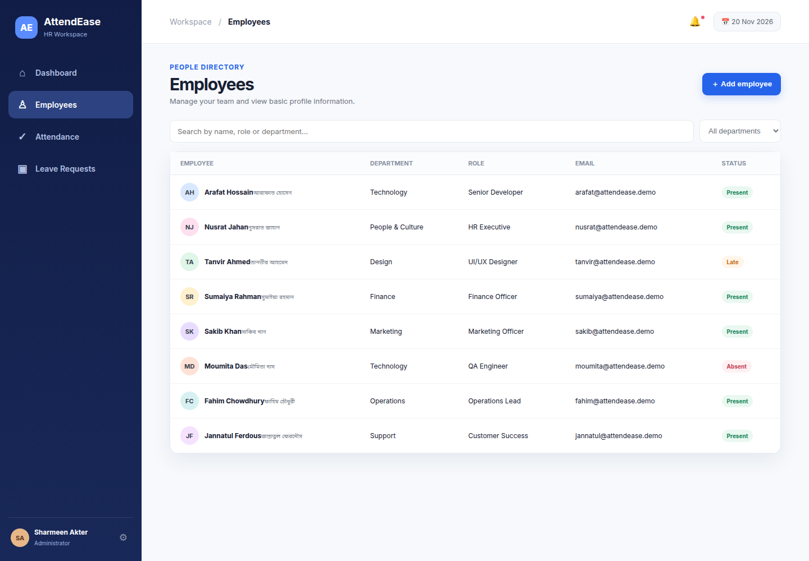
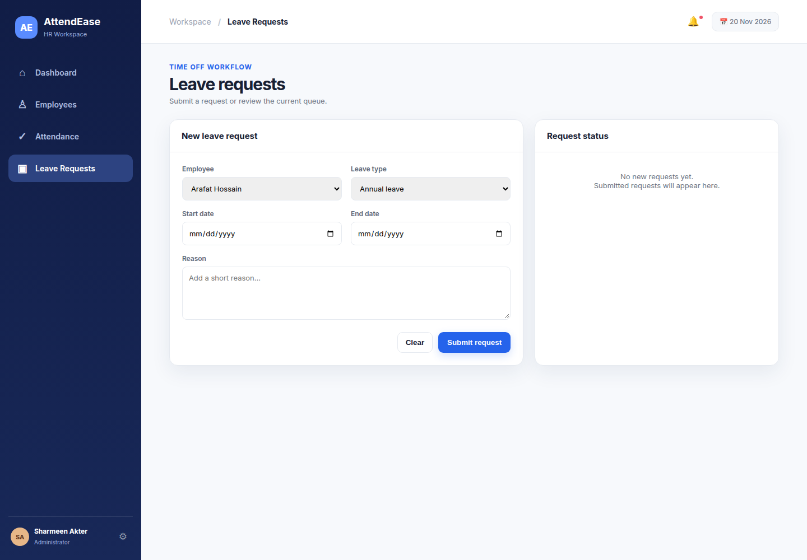
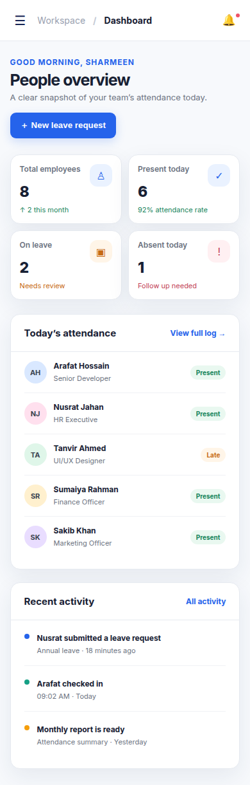

# Employee Attendance & Leave Management System
## Full Lab Report

**Course:** Management Information Systems (MIS)  
**Project type:** Front-end website using HTML, CSS and JavaScript  
**Prepared by:** ____________________  
**ID:** ____________________  
**Date:** ____________________

---

## Abstract

This project presents a responsive Employee Attendance & Leave Management System for offices, universities, NGOs and small businesses. The website provides a dashboard, employee directory, attendance register and leave-request workflow. It is implemented with semantic HTML, CSS Grid/Flexbox and vanilla JavaScript. Sample Bangladeshi employee names and synthetic AI-generated employee portraits are included for demonstration. Leave requests are stored in browser localStorage, so the prototype works without a server.

## Table of Contents

1. Introduction and Objectives  
2. Tools and Technologies  
3. Website Design  
4. Implementation with Code and Output  
5. Final Website Screenshots  
6. Main Website Pages  
7. Responsiveness  
8. Limitations and Future Improvements  
9. Conclusion

## 1. Introduction and Objectives

Manual attendance and leave tracking can create errors, duplicated records and slow approval processes. The objective of this project is to design a simple MIS interface that helps an administrator view employee status, check daily attendance and submit leave requests from one place.

The main objectives are to:

- show a clear attendance summary;
- maintain a searchable employee list;
- display daily check-in, check-out and work-hour data;
- collect leave requests through a form;
- store prototype submissions locally; and
- provide a usable interface on desktop and mobile devices.

## 2. Tools and Technologies

- **HTML5:** page structure and accessible form elements.
- **CSS3:** layout, colors, cards, tables, responsive breakpoints and visual states.
- **JavaScript (ES6):** view navigation, search/filter, dynamic rendering, form handling and localStorage.
- **Browser localStorage:** temporary client-side persistence for leave requests.
- **Headless Chromium:** output and responsive screenshot testing.

## 3. Website Design

The design uses a navy sidebar and a light workspace background. A fixed navigation menu provides access to Dashboard, Employees, Attendance and Leave Requests. Cards are used for high-level statistics, while tables are used for structured records. Green, orange and red badges communicate Present, Late and Absent states.

The demo includes eight fictional employee records: Arafat Hossain, Nusrat Jahan, Tanvir Ahmed, Sumaiya Rahman, Sakib Khan, Moumita Das, Fahim Chowdhury and Jannatul Ferdous. The portraits are synthetic AI-generated demo images and are not photographs of real people.

## 4. Implementation with Code and Output

The website is divided into three main source files:

- `index.html` contains the application shell, sidebar, topbar and script/style references.
- `style.css` contains theme variables, cards, tables, forms and responsive rules.
- `app.js` contains demo data and the four rendered views.

Important implementation features include:

```js
let leaves = JSON.parse(localStorage.getItem('attendease_leaves') || '[]');

function filterEmployees(q) {
  const list = employees.filter(e =>
    `${e.name} ${e.role} ${e.dept}`.toLowerCase().includes(q.toLowerCase())
  );
  document.getElementById('employeeRows').innerHTML = employeeRows(list);
}
```

The code uses client-side rendering for quick navigation. The leave form adds a new request to an array and saves it with `localStorage.setItem()`. The output is a working front-end demo; it does not yet include authentication or a database.

## 5. Final Website Screenshots

### Dashboard — Desktop



### People Overview — Employee Photos


The People Overview screen displays the administrator greeting, attendance summary cards and employee portraits with English and Bangla names.

### Employees — Desktop



### Leave Requests — Desktop



### Dashboard — Mobile



## 6. Main Website Pages

### Dashboard

The dashboard shows total employees, present employees, pending leave items and absences. It also includes a short attendance list and recent activity panel.

### Employees

The Employees page displays eight sample records with Bangla names, department, job role, email and status. The search box filters by name, role or department, and the dropdown filters departments.

### Attendance

The Attendance page displays a daily register with employee, date, check-in, check-out, work hours and status. The export button is a demo action that can later be connected to CSV or PDF generation.

### Leave Requests

The Leave Requests page has an employee selector, leave type, dates and reason field. On submission, the request appears in the status panel and is saved in localStorage.

## 7. Responsiveness on Different Devices

The layout is responsive through CSS media queries. On screens below 900px, the sidebar becomes a slide-out menu controlled by a menu button, the two-column content grid becomes one column, and statistics use two columns. On screens below 570px, forms use one column, text scales down, and desktop-only date controls are hidden. The mobile screenshot confirms that the dashboard remains readable at a 390px viewport.

## 8. Limitations and Future Improvements

This prototype has no server-side database, authentication, permission control or biometric integration. Data is stored only in the current browser. The attendance records are sample records and are not connected to an actual clock-in device. The next version could add a Node.js or PHP backend, MySQL database, role-based access, real approval states, CSV/PDF export, email notifications, calendar views and secure password handling.

## 9. Conclusion

The AttendEase prototype meets the core requirements of a small Employee Attendance & Leave Management System. It demonstrates a clean information architecture, useful MIS dashboards, interactive filtering, local leave submission and responsive design. The source files are simple enough for future students or developers to extend into a production system.

**Academic integrity note:** This report is an original project draft and should be reviewed, edited with the student’s own observations and submitted according to the institution’s policy. No service can guarantee or ethically remove AI-detection results; the student remains responsible for authorship and citations.
